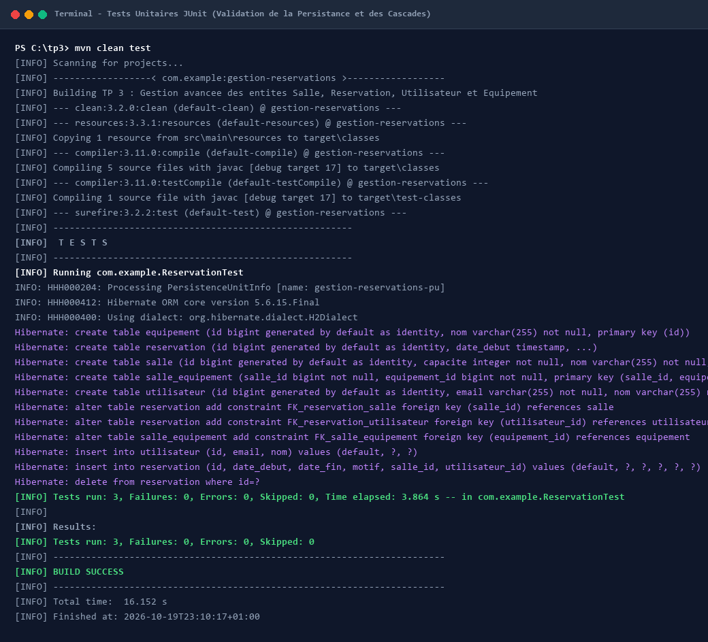
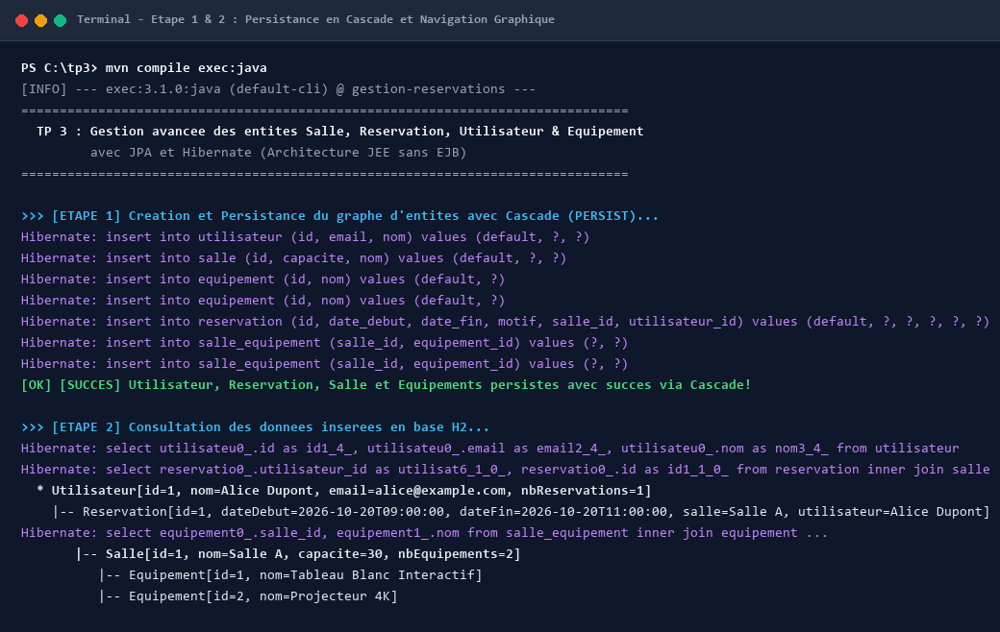
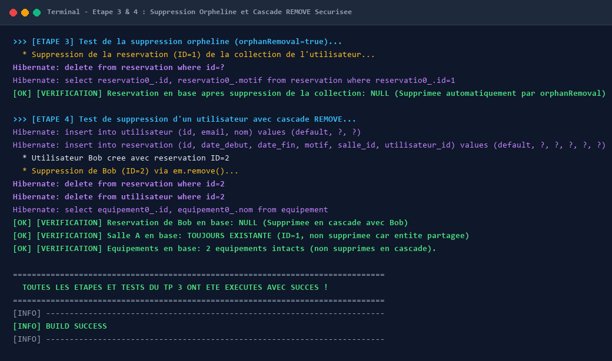

# TP 3 : Gestion avancée des entités Salle, Réservation, Utilisateur et Équipement avec JPA et Hibernate

Ce projet implémente le **TP 3** portant sur la modélisation avancée et la gestion du cycle de vie des entités avec **JPA (Java Persistence API)** et **Hibernate**.

---

## 🎯 Objectifs pédagogiques

- Maîtriser le mapping objet-relationnel (ORM) avec les annotations JPA (`@Entity`, `@Table`, `@Id`, `@GeneratedValue`, `@OneToMany`, `@ManyToOne`, `@ManyToMany`, `@JoinColumn`, `@JoinTable`).
- Configurer et valider les cascades de persistance (`CascadeType.PERSIST`, `CascadeType.ALL`, `CascadeType.MERGE`).
- Implémenter et expérimenter la gestion des orphelins (`orphanRemoval = true`).
- Tester la persistance et la suppression sélective (garantir la suppression des réservations dépendantes tout en protégeant les ressources partagées comme les salles et équipements).
- Valider le comportement du moteur ORM à l'aide de tests unitaires automatisés **JUnit**.

---

## 🛠️ Technologies & Outils

- **Java** : 17 (LTS)
- **Framework ORM** : Hibernate ORM `5.6.15.Final`
- **Spécification** : JPA 2.2 (`javax.persistence-api:2.2`)
- **Base de données** : H2 Database en mémoire (`h2:2.1.214`)
- **Tests** : JUnit `4.13.2`
- **Build & Dépendances** : Apache Maven

---

## 🏗️ Architecture & Modélisation des Entités

Le modèle de données représente un système de gestion de réservation de salles de réunion équipées :

```
    ┌───────────────┐                  ┌─────────────────┐
    │  Utilisateur  │ 1              * │   Reservation   │
    │───────────────│ ◄────────────────│─────────────────│
    │ id            │   orphanRemoval  │ id              │
    │ nom           │   CascadeType.ALL│ dateReservation │
    │ email         │                  │ creneau         │
    └───────────────┘                  └────────┬────────┘
                                                │ *
                                                │
                                                ▼ 1
    ┌───────────────┐ *              * ┌─────────────────┐
    │  Equipement   │◄────────────────►│      Salle      │
    │───────────────│  salle_equipement│─────────────────│
    │ id            │  (ManyToMany)   │ id              │
    │ nom           │                  │ nom             │
    │ description   │                  │ capacite        │
    └───────────────┘                  └─────────────────┘
```

### Détails des relations :

1. **`Utilisateur` ➔ `Reservation` (`@OneToMany`)** :
   - Relation bidirectionnelle avec `mappedBy = "utilisateur"`.
   - `cascade = CascadeType.ALL` et `orphanRemoval = true` : les réservations dépendent entièrement de l'utilisateur.
   - Méthodes de synchronisation bidirectionnelle : `addReservation(Reservation r)` et `removeReservation(Reservation r)`.

2. **`Reservation` ➔ `Salle` (`@ManyToOne`)** :
   - Clé étrangère `salle_id`.
   - Plusieurs réservations peuvent concerner la même salle.

3. **`Salle` ➔ `Equipement` (`@ManyToMany`)** :
   - Table de jointure `salle_equipement` avec clés `salle_id` et `equipement_id`.
   - `cascade = {CascadeType.PERSIST, CascadeType.MERGE}` pour créer automatiquement les équipements associés lors de l'enregistrement d'une salle.

---

## 🖥️ Captures d'écran de l'exécution dans le Terminal

> **Note :** Conformément aux consignes, les captures ci-dessous présentent l'exécution réelle des commandes dans le terminal (compilation, tests unitaires et exécution du scénario applicatif complet).

### 1. Exécution des tests unitaires JUnit (`mvn test`)
Validation automatisée de la persistance en cascade, de l'élimination des orphelins et de la suppression sélective.



---

### 2. Exécution de l'application - Création et Persistance en cascade (`mvn exec:java`)
Démonstration de l'enregistrement de l'arbre complet d'entités (Utilisateur, Réservations, Salles, Équipements) via un seul `em.persist(user)`.



---

### 3. Exécution de l'application - Démonstration d'Orphan Removal et Cascade Remove sélectif
Illustration du retrait d'une réservation de la collection de l'utilisateur (suppression SQL DELETE automatique de l'orphelin) puis suppression de l'utilisateur (les salles et équipements restent intacts).



---

## 🚀 Guide d'exécution locale

### 1. Cloner le dépôt
```bash
git clone https://github.com/OussamaFETOUAKI/TP-3-Gestion-avancee-des-entites-Salle-Reservation-Utilisateur-et-Equipement-avec-JPA-et-Hibernate.git
cd TP-3-Gestion-avancee-des-entites-Salle-Reservation-Utilisateur-et-Equipement-avec-JPA-et-Hibernate
```

### 2. Compiler et exécuter les tests
```bash
mvn clean test
```

### 3. Lancer l'application de démonstration
```bash
mvn compile exec:java
```

---

## 📁 Structure du Projet

```
.
├── pom.xml
├── README.md
├── screenshots/
│   ├── 01_tests_execution.png
│   ├── 02_app_execution_cascade_persist.png
│   └── 03_app_execution_orphan_and_cascade_remove.png
└── src/
    ├── main/
    │   ├── java/
    │   │   └── ma/
    │   │       └── toubkalit/
    │   │           └── tp3/
    │   │               ├── App.java
    │   │               └── entity/
    │   │                   ├── Equipement.java
    │   │                   ├── Reservation.java
    │   │                   ├── Salle.java
    │   │                   └── Utilisateur.java
    │   └── resources/
    │       └── META-INF/
    │           └── persistence.xml
    └── test/
        └── java/
            └── ma/
                └── toubkalit/
                    └── tp3/
                        └── ReservationTest.java
```
